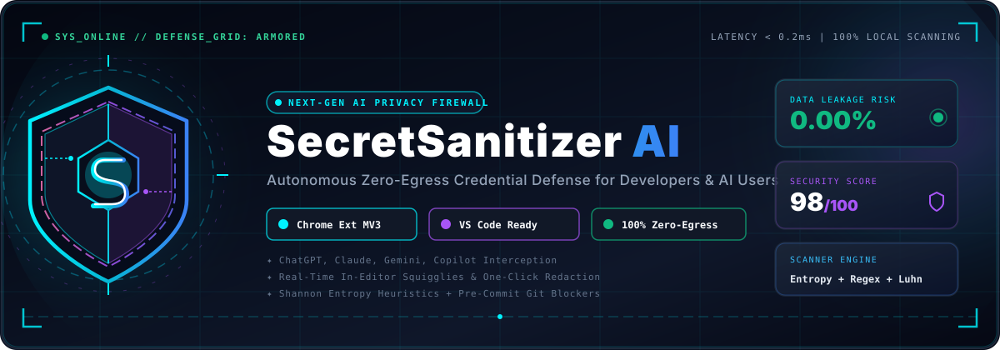
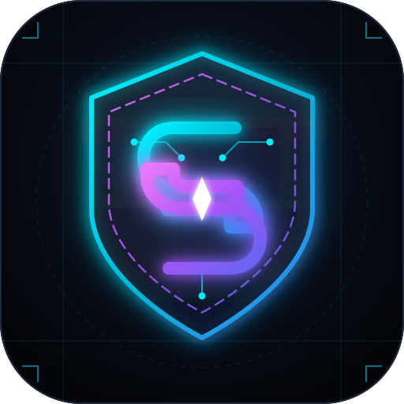

<p align="center">
  
</p>

<p align="center">
  <a href="https://github.com/gitwithmasum/SecretSanitizer-AI"></a>
  <a href="https://github.com/gitwithmasum/SecretSanitizer-AI"></a>
  <a href="https://github.com/gitwithmasum/SecretSanitizer-AI"></a>
  <a href="https://github.com/gitwithmasum/SecretSanitizer-AI"></a>
  <a href="https://github.com/gitwithmasum/SecretSanitizer-AI"></a>
</p>

---

## 🌟 Executive Overview

**SecretSanitizer AI** is a production-oriented, privacy-first cybersecurity platform and AI firewall engineered to detect, classify, sanitize, and intercept credentials, infrastructure URIs, sensitive tokens, and context-aware PII before they can accidentally leak into third-party AI interfaces, public repositories, or system clipboards.

Available as both a **Chrome Browser Extension (Manifest V3)** and a **VS Code Developer Extension** sharing a high-performance deterministic scanning core.

### 🛡️ Non-Negotiable Privacy Guarantees
1. **100% Local Scanning**: Zero network egress. No code, prompt, or credential ever leaves your browser or editor sandbox.
2. **Deterministic & Contextual Accuracy**: Multistage detection engine combining regex token heuristics, **Shannon Entropy analysis** ($H \ge 3.6$ to $4.5$), character set distributions, and proximity keyword boosting to suppress false positives on UUIDs, hashes, and commits.
3. **Format-Preserving Sanitization**: Redacts sensitive values while strictly preserving code indentation, line breaks, variable names, JSON/YAML/SQL syntax, and formatting.
4. **Resilient AI Firewall Adapters**: Dedicated DOM hooks for **ChatGPT**, **Claude**, **Google Gemini**, **Microsoft Copilot**, **Perplexity**, and generic web inputs with **Shadow-DOM modal interception**.
5. **Git Pre-Commit Blocker**: Automated hook that inspects staged files and rejects commits containing unredacted secrets.

---

## 🧩 Architectural Ecosystem

<p align="center">
  
</p>

```
                              SECRETSANITIZER AI
                                 (Core Engine)
                                       │
                ┌──────────────────────┴──────────────────────┐
                │                                             │
      🌐 CHROME EXTENSION                           ⚡ VS CODE EXTENSION
      (Manifest V3 Runtime)                         (Editor Development Host)
        │                                             │
        ├─ AI Privacy Firewall                        ├─ Real-Time On-Type Squigglies
        ├─ ChatGPT / Claude / Gemini Adapters         ├─ Quick Fix Redaction (Ctrl + .)
        ├─ Shadow DOM Review Modal                    ├─ Threat Assessment Hover Tooltips
        ├─ Dedicated Clipboard Guardian               ├─ Activity Bar Sidebar Tree View
        ├─ Cyberpunk Dashboard SPA (9 Modules)        ├─ In-Editor Dashboard Webview
        └─ Quick Text & File Scanner                  └─ Automated Git Pre-Commit Hook
```

---

## 🌐 1. Chrome Extension (Manifest V3)

### Features:
- **AI Privacy Firewall**: Intercepts Enter keystrokes and submit buttons before content leaves the page.
- **Shadow DOM Security Modal**: Rendered in an isolated Shadow Root (`z-index: 2147483647`), immune to host page CSS conflicts.
- **Three Protection Policies**:
  1. *Review Before Redaction* (Recommended): In-page modal with masked before-and-after preview.
  2. *Automatic Redaction*: Silently replaces credentials with placeholders and submits seamlessly.
  3. *Warning Only*: Alerts developer without blocking submission.
- **Dedicated Clipboard Guardian**: Intercepts `copy` events locally to prevent accidental clipboard exposure.
- **Interactive Security Dashboard (9 Modules)**:
  - Overview & Weekly Activity Chart
  - Developer Code Scanner (drag & drop, multi-file, syntax preservation)
  - Preloaded Security Test Lab (synthetic test fixtures)
  - AI Firewall Adapter Diagnostics
  - Detection Center Knowledge Base (active signatures)
  - Activity Center (masked audit logs with JSON/CSV export)
  - Custom Rules Editor with **Catastrophic Backtracking (ReDoS) Defense**
  - Enterprise Governance & Automated **SOC 2 / ISO 27001 / GDPR** Reports
  - Privacy Settings & Complete Zero-Residue Data Erasure

### Quick Start (Load Unpacked in Chrome):
1. Build the production extension:
   ```bash
   npm run build
   ```
2. Open Google Chrome and navigate to `chrome://extensions/`.
3. Toggle **Developer mode** (top-right corner).
4. Click **Load unpacked** and select the `dist/` directory:
   ```
   d:\OneDrive\Web Development\SecretSanitizer\dist
   ```
5. Pin the extension to your toolbar.

---

## ⚡ 2. VS Code Extension

### Features:
- **Real-Time On-Type Diagnostics**: Highlights secrets with exact character and line coordinates as you type or save.
  - 🔴 Critical: Red squiggly error (API Keys, DB Connection Strings)
  - 🟡 High/Medium: Yellow squiggly warning (JWTs, Bearer headers, Tokens)
  - 🔵 Low/PII: Blue info underline (Credit cards, SSN, Internal IPs)
- **💡 Quick Fix Lightbulb (`Ctrl + .` / `Cmd + .`)**:
  - *🛡️ Redact Secret with [REDACTED_...]*: Instantly replaces highlighted token with safe placeholder.
  - *📋 Redact All Secrets in Current File*: Batch-sanitizes the entire document with preserved formatting.
  - *💡 Explain Secret Exposure Risk*: Opens detailed threat and remediation summary.
- **Hover Tooltips**: Rich Markdown popups displaying classification, masked value, threat impact, blast radius, and rotation steps.
- **Activity Bar Sidebar**: Custom shield icon in the left activity bar showing a live TreeView of all detected secrets across your workspace. Click any finding to jump directly to the code.
- **Interactive Dashboard Webview**: Run `SecretSanitizer: Open Security Dashboard & Metrics` to inspect security posture inside VS Code.
- **🛑 Automated Git Pre-Commit Hook**: Run `SecretSanitizer: Install Git Pre-Commit Secret Scanner Hook` to protect `.git/hooks/pre-commit` from accidental secret commits.

### Quick Start (Run & Test in VS Code):
```bash
# 1. Compile the VS Code extension
npm run build:vscode

# 2. Launch in VS Code
# Press F5 in VS Code (Launch Extension Host)
```

To package into an installable `.vsix` file:
```bash
cd vscode-extension
npx @vscode/vsce package --no-dependencies
code --install-extension secretsanitizer-ai-vscode-1.0.0.vsix
```

---

## 🎯 Supported Detectors & Signatures

| Category | Detectors & Signatures | Default Placeholder |
| :--- | :--- | :--- |
| **API Credentials** | OpenAI Keys (`sk-proj-...`, `sk-...`), Anthropic Claude Keys (`sk-ant-api03-...`), AWS Access Key IDs (`AKIA...`) & Secrets, Stripe Keys (`sk_live_...`, `rk_live_...`), GitHub PAT (`ghp_...`, `github_pat_...`), GitLab Tokens (`glpat-...`), Google API Keys (`AIza...`), Slack Tokens (`xoxb-...`), Discord Bot Tokens, Twilio SIDs, SendGrid Keys, Cloudflare Tokens, Generic High-Entropy API Secrets | `[REDACTED_API_KEY]`, `[REDACTED_STRIPE_SECRET]`, `[REDACTED_AWS_KEY]` |
| **Authentication Secrets** | Signed JWT Tokens, Bearer Authorization Headers, Basic Authentication Headers, Hardcoded Passwords in config/connection strings, OAuth Refresh Tokens | `[REDACTED_JWT_TOKEN]`, `Bearer [REDACTED_AUTH_TOKEN]`, `[REDACTED_PASSWORD]` |
| **Infrastructure Secrets** | PostgreSQL Connection URIs (`postgres://...`), MySQL URIs, MongoDB Connection Strings, Redis URIs with Passwords, Private SSH Keys (`BEGIN RSA/OPENSSH PRIVATE KEY`), TLS/PEM Private Keys, Docker Registry Auth, Kubernetes Tokens | `[REDACTED_POSTGRES_URI]`, `[REDACTED_SSH_PRIVATE_KEY]`, `[REDACTED_MONGODB_URI]` |
| **PII & Business Information** | Credit Card Numbers (validated by **Luhn Algorithm Mod 10**), US Social Security Numbers (SSN), Internal RFC-1918 IP Addresses (`10.x`, `172.16-31.x`, `192.168.x`), Internal Enterprise Hostnames (`*.internal`, `*.corp`), Phone Numbers, Customer Emails | `[REDACTED_CREDIT_CARD]`, `[REDACTED_SSN]`, `[REDACTED_INTERNAL_IP]` |

---

## ⌨️ VS Code Command Shortcuts

| Command | Keybinding | Description |
| :--- | :--- | :--- |
| `secretsanitizer.scanActiveFile` | `Ctrl + Alt + S` | Scan the current open file for secrets |
| `secretsanitizer.sanitizeSelection` | `Ctrl + Alt + R` | Sanitize and redact highlighted text |
| `secretsanitizer.scanWorkspace` | Command Palette | Scan all files in workspace with progress reporting |
| `secretsanitizer.sanitizeActiveFile` | Command Palette | Redact entire active document (in-place or diff) |
| `secretsanitizer.openDashboard` | Command Palette | Open the embedded security dashboard webview |
| `secretsanitizer.installPreCommitHook`| Command Palette | Install Git pre-commit secret blocker |
| `secretsanitizer.toggleRealtime` | Command Palette | Toggle on-type background scanning |

---

## 🧪 Automated Testing & Quality Assurance

Run the comprehensive Vitest test suite with:
```bash
npm run test
```

```
 RUN  v3.2.7 D:/OneDrive/Web Development/SecretSanitizer

 ✓ tests/unit/entropy.test.ts (6 tests)
 ✓ tests/unit/enterprise.test.ts (3 tests)
 ✓ tests/unit/detectors.test.ts (14 tests)
 ✓ tests/unit/custom-rules.test.ts (4 tests)
 ✓ tests/unit/sanitizer.test.ts (4 tests)

 Test Files  5 passed (5)
      Tests  31 passed (31) 100% Success
```

---

## 📚 Deliverables & Documentation

- **Security Architecture & Mathematical Model**: [docs/SECURITY_ARCHITECTURE.md](docs/SECURITY_ARCHITECTURE.md)
- **Privacy Policy Draft**: [docs/PRIVACY_POLICY.md](docs/PRIVACY_POLICY.md)
- **Chrome Web Store Submission Checklist**: [docs/CHROME_WEB_STORE_CHECKLIST.md](docs/CHROME_WEB_STORE_CHECKLIST.md)
- **Enterprise Governance Roadmap**: [docs/ENTERPRISE_ROADMAP.md](docs/ENTERPRISE_ROADMAP.md)
- **VS Code Extension Guide**: [vscode-extension/README.md](vscode-extension/README.md)

---

## 📄 License & Privacy
- **License**: MIT
- **Privacy Assurance**: 100% Client-Side. Zero Cloud Egress. Zero Raw Secret Storage.
