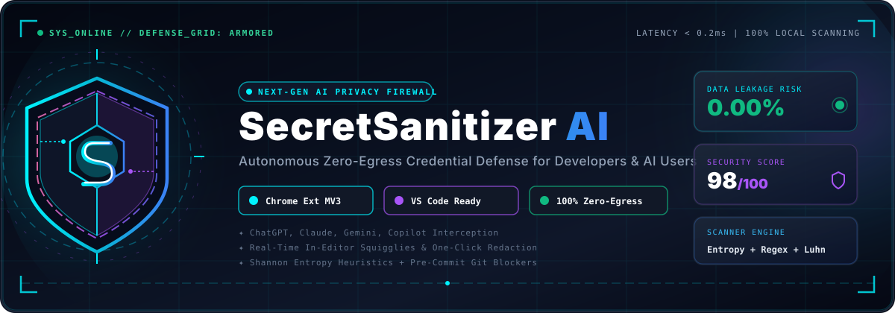

<p align="center">
  
</p>

# SecretSanitizer AI — VS Code Extension 🛡️
### Real-Time Developer Privacy Firewall, Credential Scanner & In-Editor Redaction

<p align="center">
  
</p>

<p align="center">
  <a href="https://github.com/gitwithmasum/SecretSanitizer-AI"></a>
  <a href="https://github.com/gitwithmasum/SecretSanitizer-AI"></a>
  <a href="https://github.com/gitwithmasum/SecretSanitizer-AI"></a>
</p>

**SecretSanitizer AI** brings military-grade, privacy-first secret scanning directly into your VS Code editor. It detects API keys, database connection strings, authentication tokens, and PII in real-time as you type, providing instant inline squigglies, one-click Quick Fix redaction, and automated Git pre-commit guardrails.

---

## ⚡ Core Features in VS Code

### 1. 🔍 Real-Time In-Editor Squigglies & Diagnostics
- Scans active files on open, on type (debounced), and on save.
- Highlights leaked credentials with precise line & character bounds:
  - **Critical Severity** (e.g. OpenAI Keys, AWS Secrets, Stripe Live Keys): Red squiggly error.
  - **High/Medium Severity** (e.g. JWTs, Bearer headers, Database URIs): Yellow squiggly warning.
  - **Low Severity / PII** (e.g. Credit cards, SSNs, Internal IPs): Blue info underline.

### 2. 💡 One-Click Quick Fix Redaction (`Ctrl + .` / `Cmd + .`)
- Place cursor over any detected secret and press `Ctrl+.` (or `Cmd+.` on macOS):
  - **Redact Secret**: Immediately replaces the raw secret with a safe, meaningful placeholder (e.g., `[REDACTED_STRIPE_SECRET]`, `[REDACTED_POSTGRES_URI]`).
  - **Redact All Secrets in File**: Sanitizes all credentials across the file while strictly preserving code formatting, indentation, and variable names.

### 3. 🛡️ Rich Threat Assessment Hover Tooltips
- Hovering over a flagged credential displays:
  - Token Classification and Detection Rule ID
  - Safe Masked Value (e.g. `sk-proj-...8aB9`)
  - **Threat Assessment**: Specific impact description and estimated blast radius
  - **Immediate Remediation**: Step-by-step guidance on credential rotation and secure `.env` storage

### 4. 🗂️ Activity Bar Sidebar Tree View
- Dedicated **SecretSanitizer AI** shield icon in the Activity Bar.
- Hierarchical tree view listing all workspace files with active leaks.
- Click any finding to instantly jump the editor to the exact line and column.

### 5. 📊 Interactive Security Dashboard Webview
- Run `SecretSanitizer: Open Security Dashboard & Metrics` to open an in-editor dark cybersecurity dashboard displaying security scores, leak metrics, and active findings.

### 6. 🛑 Git Pre-Commit Hook Guardrail
- Run `SecretSanitizer: Install Git Pre-Commit Secret Scanner Hook`.
- Installs an automated scanner in `.git/hooks/pre-commit` that blocks any `git commit` if staged files contain unredacted secrets.

---

## 🚀 How to Run & Test Locally in VS Code

### Method 1: Run via Extension Development Host (F5)
1. Open this project folder in VS Code:
   ```bash
   code "d:\OneDrive\Web Development\SecretSanitizer"
   ```
2. Build the extension:
   ```bash
   npm run build:vscode
   ```
3. Open `vscode-extension/src/extension.ts` in VS Code and press **F5** (or go to **Run and Debug** > **Launch Extension**).
4. A new **Extension Development Host** window will open with SecretSanitizer AI active!
5. Open any file or paste a sample key (`sk-proj-example...`) to see real-time squigglies, hover tooltips, and quick-fixes in action.

---

### Method 2: Package into `.vsix` & Install Globally
To create an installable `.vsix` file for yourself or your team:

```bash
# 1. Compile the extension
npm run build:vscode

# 2. Package into a .vsix file
cd vscode-extension
npx @vscode/vsce package --no-dependencies

# 3. Install in VS Code
code --install-extension secretsanitizer-ai-vscode-1.0.0.vsix
```

---

## ⌨️ Command Shortcuts

| Command | Keybinding | Description |
| :--- | :--- | :--- |
| `secretsanitizer.scanActiveFile` | `Ctrl + Alt + S` | Scan the current open file for secrets |
| `secretsanitizer.sanitizeSelection` | `Ctrl + Alt + R` | Sanitize and redact highlighted text |
| `secretsanitizer.scanWorkspace` | Command Palette | Scan all code and config files in workspace |
| `secretsanitizer.sanitizeActiveFile` | Command Palette | Sanitize entire active document with diff preview |
| `secretsanitizer.openDashboard` | Command Palette | Open the embedded security dashboard webview |
| `secretsanitizer.installPreCommitHook`| Command Palette | Install Git pre-commit secret blocker |
| `secretsanitizer.toggleRealtime` | Command Palette | Toggle on-type background scanning |

---

## ⚙️ Extension Settings

Configure via VS Code Settings (`Ctrl+,`):
- `secretsanitizer.enableRealtimeScanning`: Enable/disable background scanning on type (default: `true`).
- `secretsanitizer.scanOnSave`: Scan and update diagnostics whenever a file is saved (default: `true`).
- `secretsanitizer.detectPII`: Detect credit card numbers (Luhn checked), SSNs, and internal IPs (default: `true`).
- `secretsanitizer.sensitivity`: `balanced` (default), `aggressive`, `low`.
